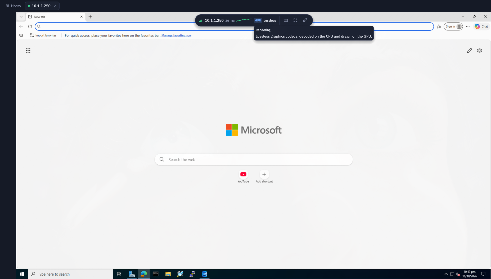
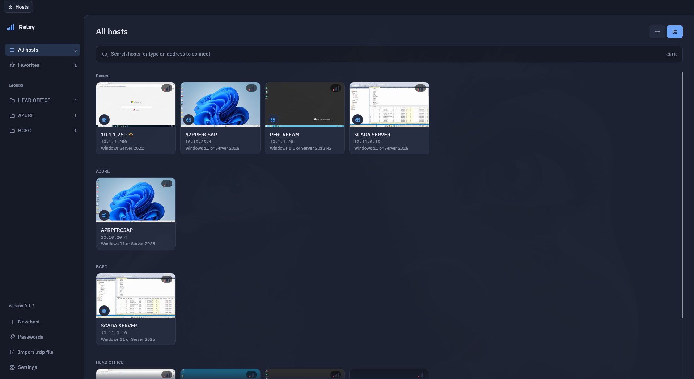

# Relay

**A fast, low-latency RDP client for Linux, built for Wayland.**
Written in Rust, with an [egui](https://github.com/emilk/egui) interface drawn on the GPU.

[](#license)
[](https://www.rust-lang.org)
[](https://github.com/emilk/egui)
[](https://wayland.freedesktop.org)
[](#downloads)

Relay connects to Windows desktops and servers over the Remote Desktop Protocol. Decoded video
never leaves the GPU, network writes aren't held back, and the whole screen is composed in one
GPU submission per frame. The goal is a remote desktop that feels local, using a fraction of the
CPU other clients need.

In the same full-screen test, Relay used **4.4× less CPU than xfreerdp** and **5.8× less than
sdl-freerdp** ([details](#head-to-head-with-freerdp)).





## Contents

- [Why it's fast](#why-its-fast)
- [Benchmarks](#benchmarks)
- [Features](#features)
- [Downloads](#downloads)
- [Usage](#usage)
- [Current limitations](#current-limitations)
- [Building from source](#building-from-source)
- [Built with](#built-with)
- [License](#license)

## Why it's fast

| | How Relay does it |
| --- | --- |
| **Zero-copy video** | H.264 is decoded by your GPU through VA-API, shared with Vulkan as DMA-BUF, converted from YUV in shaders and drawn as an egui texture. Frames are never copied back to system memory. |
| **One GPU submission per frame** | Fills, copies, cached bitmaps and decoded tiles are recorded together and submitted once at the end of each RDP frame, with a bound on outstanding GPU work. |
| **GPU RemoteFX** | RemoteFX tiles are entropy-decoded in parallel on every CPU core; the wavelet transform and color conversion run in GPU compute shaders. |
| **No network buffering delay** | `TCP_NODELAY` is set on the connection and input uses RDP fast-path, so keystrokes and mouse moves go out the moment they happen. |
| **Native Wayland** | A native Wayland window (no XWayland), with dynamic resize: the remote desktop follows your window size. |
| **Written in Rust** | No garbage collector and no runtime pauses, with memory safety throughout. The protocol stack is [IronRDP](https://github.com/Devolutions/IronRDP), also in Rust. |
| **egui interface** | An immediate-mode UI rendered with wgpu in the same GPU pipeline as the remote desktop. |

## Benchmarks

All numbers below were measured on one laptop on 2026-10-16, at commit `f5cacb5`, with release builds.

| Test machine | |
| --- | --- |
| CPU | AMD Ryzen 7 5800HS (8 cores, 16 threads) |
| GPU used | AMD Radeon Vega integrated graphics (Mesa 26.2.2, RADV and radeonsi VA-API) |
| Memory | 22 GB |
| Display | 1920×1080, 144 Hz |
| System | Arch Linux (Omarchy), kernel 7.2.5, Hyprland 0.56.2, FFmpeg 9.0.1, OpenH264 2.6.0 |

### H.264 video: hardware vs software path

A synthetic 1080p H.264 stream at 12 Mbit/s, decoded until the picture is ready on the GPU.
Median of three runs.

| Decoding path | Time per frame | CPU per frame |
| --- | ---: | ---: |
| **Relay hardware: VA-API → DMA-BUF → Vulkan** | **2.10 ms** | **0.36 ms** |
| Relay software: OpenH264 → GPU upload | 4.89 ms | 3.81 ms |

The hardware path is **2.3× faster** and uses **10× less CPU**. At 2.1 ms per frame, a 1080p
frame fits well inside a 144 Hz display's 6.9 ms frame budget.

### Lossless and RemoteFX drawing

Full 1920×1080 frames: the worst case, where the entire screen changes at once. Median of three runs.

| Workload (1920×1080) | Time | CPU |
| --- | ---: | ---: |
| Lossless desktop frame on the GPU: tiles, glyphs, cached bitmaps, fills and a scroll | 5.88 ms | 2.2 ms on the session thread |
| RemoteFX full screen, wavelets on the GPU | 8.82 ms | 43.5 ms over all cores |
| RemoteFX full screen, decoded on the CPU and uploaded | 8.16 ms | 77.7 ms over all cores |

Moving the wavelet transform to the GPU cuts RemoteFX CPU time by **44%**.

| Stream decompression (ZGFX) | Throughput |
| --- | ---: |
| ClearCodec/NSCodec stream | 324 MB/s |
| RemoteFX full-screen picture (1.9 MB) | 169 MB/s |

### Real sessions

Decoding times from Relay's own logs over 25.5 minutes of everyday use against Windows servers
(12,497 frames).

| Codec | Updates | Data | Average decode time per update |
| --- | ---: | ---: | ---: |
| ClearCodec | 29,832 | 83.8 MB | 0.058 ms |
| RemoteFX progressive | 5,654 | 76.4 MB | 0.775 ms |

On average, decoding took **0.49 ms per frame**, about **0.4%** of session time.

### Head-to-head with FreeRDP

Each client received the same animated 1920×1080 RemoteFX stream from a local test server,
paced at one frame every 16 ms. CPU and memory of the whole client process were read from
`/proc` over 60 seconds, after 10 seconds of warm-up. Two runs per client; the table shows the average.

| Client | CPU (100% = one core) | Peak memory | Threads |
| --- | ---: | ---: | ---: |
| **Relay 0.1.2** | **17.4%** | 187 MB | 22 |
| xfreerdp3 3.31.1 (X11, under XWayland) | 76.2% | 131 MB | 25 |
| sdl-freerdp3 3.31.1 (SDL3, Wayland) | 100.4% | 221 MB | 35 |

Relay used **4.4×** less CPU than xfreerdp3 and **5.8×** less than sdl-freerdp3. xfreerdp3 used
the least memory.

Notes on fairness:
- Relay and xfreerdp3 ran fullscreen. sdl-freerdp3 can't go fullscreen on Hyprland, so it ran in
  a window with a 1920×1080 remote desktop. All three decoded the same 1920×1080 stream.
- This compares RemoteFX, which every client decoded on the CPU. An H.264 comparison wasn't
  possible: FreeRDP's FFmpeg decoder rejected the test server's H.264 stream.
- These numbers measure decoding and drawing cost. End-to-end latency (from a key press to the
  updated picture on screen) hasn't been measured yet.

<details>
<summary>Reproduce these benchmarks</summary>

The decoding benchmarks are ignored tests that report their timings:

```sh
cargo test --release --bin relay -- --ignored --nocapture --test-threads=1 \
  hardware_software_latency_comparison gpu_lossless_frame_throughput \
  gpu_progressive_throughput progressive_decode_throughput zgfx_decompression_throughput
```

Every minute, and when a session ends, Relay logs a `graphics traffic` line with each codec's
updates, size and decoding time (see [docs/GRAPHICS.md](docs/GRAPHICS.md)).

For the head-to-head, run the local test server (user and password `test`) and connect each
client to `127.0.0.1:3390` at 1920×1080:

```sh
cargo run --release --example test_server -- --port 3390
```

</details>

## Features

- **Graphics modes**: Balanced (H.264 for motion, lossless codecs for text), Full color (H.264
  4:4:4 for sharp colored text), Sharp text (lossless only), and Compatible (classic RemoteFX for
  older servers). The
  session bar shows whether the GPU or CPU is drawing, and which codec is in use.
- **Hardware video decoding** through VA-API, with automatic fallback to OpenH264 and to CPU drawing.
- **Dynamic resize**: the remote desktop follows the window. Fixed resolutions and scaling are also available.
- **Clipboard**: text, images and files in both directions. Files copied in your file manager paste
  in Windows Explorer, and the other way round.
- **Shared folders**: local folders appear as drives on the remote computer.
- **Audio** playback from the remote computer.
- **Host library**: saved hosts as a list or as tiles with live snapshots, groups and favorites,
  and automatic Windows version detection.
- **Credential profiles**: named accounts shared across hosts, with passwords in the system keyring.
- **.rdp files**: open them directly or import them into the library.
- **Automatic reconnect** after network drops.
- **TLS**: rustls first, then an OpenSSL retry for servers that need older cipher suites; an
  optional per-host legacy mode for Windows 7 and Server 2008 R2.
- Tested with hosts from Windows Server 2008 to current Windows 10 and 11 family releases.

## Downloads

Packages for x86_64 Linux are on the [Releases page](https://github.com/jajardinero/relay-rdp/releases/latest).

| Distribution | Download | Install |
| --- | --- | --- |
| Any (AppImage) | [Relay-0.1.2-x86_64.AppImage](https://github.com/jajardinero/relay-rdp/releases/download/v0.1.2/Relay-0.1.2-x86_64.AppImage) | `chmod +x Relay-0.1.2-x86_64.AppImage && ./Relay-0.1.2-x86_64.AppImage` |
| Debian 13 | [relay_0.1.2-1_debian13_amd64.deb](https://github.com/jajardinero/relay-rdp/releases/download/v0.1.2/relay_0.1.2-1_debian13_amd64.deb) | `sudo apt install ./relay_0.1.2-1_debian13_amd64.deb` |
| Ubuntu 24.04 | [relay_0.1.2-1_ubuntu24.04_amd64.deb](https://github.com/jajardinero/relay-rdp/releases/download/v0.1.2/relay_0.1.2-1_ubuntu24.04_amd64.deb) | `sudo apt install ./relay_0.1.2-1_ubuntu24.04_amd64.deb` |
| Fedora 44 | [relay-0.1.2-1.fc44.x86_64.rpm](https://github.com/jajardinero/relay-rdp/releases/download/v0.1.2/relay-0.1.2-1.fc44.x86_64.rpm) | `sudo dnf install ./relay-0.1.2-1.fc44.x86_64.rpm` |
| Arch Linux | [relay-0.1.2-1-x86_64.pkg.tar.zst](https://github.com/jajardinero/relay-rdp/releases/download/v0.1.2/relay-0.1.2-1-x86_64.pkg.tar.zst) | `sudo pacman -U relay-0.1.2-1-x86_64.pkg.tar.zst` |

Check your download against the release's `SHA256SUMS`:

```sh
sha256sum --check --ignore-missing SHA256SUMS
```

**Requirements:** a Wayland desktop and a Vulkan driver. For hardware video decoding, a VA-API
driver with H.264 (Mesa for AMD, `intel-media-driver` for Intel). Optional: `libopenh264.so.8`
for software H.264, a Secret Service provider (such as GNOME Keyring) to save passwords, and
`fuse3` to paste files copied on the remote computer.

The AppImage bundles FFmpeg, OpenSSL and OpenH264. It needs glibc 2.39 or newer (Ubuntu 24.04,
Debian 13, Fedora 40 and later). If your system has no FUSE, start it with
`--appimage-extract-and-run`.

## Usage

```sh
relay                          # open the host library
relay dc01.corp.example.com    # connect; host or host:port
relay --user 'CORP\jdoe' dc01  # preset the user name
relay ~/Downloads/desk.rdp     # connect with a .rdp file's settings
```

Set `RELAY_PASSWORD` to sign in without the password prompt (for scripts). An address that
matches a saved host uses that host's settings and saved password.

| Shortcut | Action |
| --- | --- |
| Ctrl+Alt+Enter | Toggle fullscreen |
| Ctrl+Alt+Home | Show the session bar and release system shortcuts |
| Ctrl+Alt+End | Send Ctrl+Alt+Del |

System shortcuts such as Super and Alt+Tab go to the remote computer only in fullscreen.
**Settings → Keyboard** changes this.

**Hosts.** **+ New host** opens the host editor. Each host has a **Quality** setting (Best,
Balanced or Low bandwidth) that tells the server what kind of link you're on and sets visual
effects to match, and a graphics mode under **Experience**. **Import .rdp file** opens a `.rdp`
file in the editor so you can review and save it. Relay reads its address, user name, domain,
display, connection speed, visual effects, audio, clipboard and load-balancing settings, and
lists any setting it can't use yet.

**Snapshots.** In tile view, a host shows a snapshot of its screen, taken 10 seconds after a
session's picture appears, every two minutes while it stays live, and when you close it.
Snapshots are small PNGs in `~/.local/share/relay/previews`, **stored unencrypted**.
**Settings → Desktop previews** turns them off and deletes them.

**Passwords.** **Passwords**, below **+ New host**, manages credential profiles: named accounts
with a user name, optional domain and password. Passwords stay in the system keyring;
`credentials.toml` holds only account metadata. Choose a profile under **Sign-in → Credentials**
in a host's editor, or in the sign-in prompt. Editing a profile affects future connections of
every host that uses it; deleting one asks first and makes its hosts prompt for credentials.

**Clipboard and files.** With **Clipboard** on (the host editor's **Devices** section), copied
text, images and files go both ways. Copying a folder includes its contents (up to 20,000
entries; links to other folders inside it are skipped). Files copied on the remote computer show
up in a read-only folder under `$XDG_RUNTIME_DIR/relay` and are fetched only as they're read, so
your file manager's copy dialog shows the transfer. **Shared folders** in the same section
appear as drives under This PC on the remote computer.

**TLS.** Relay prefers rustls. If a server needs compatibility ciphers, it retries once with
OpenSSL, which adds TLS 1.2 ECDHE-RSA AES-CBC/SHA-2; TLS 1.0 and 1.1 stay disabled. For old
servers that only offer TLS 1.0 (Windows 7 or Server 2008 R2 without the TLS 1.2 update), turn
on **Allow legacy TLS** in the host's **Advanced** section. It's off by default, and each
connection that uses it is logged as a warning. Enabling TLS 1.2 on the server is the better fix.
Both backends use the same certificate approval and saved fingerprints.

Logs are in `~/.local/state/relay/logs`. For how sessions are drawn, the `graphics traffic` log
lines, and diagnosing servers that don't send H.264, see [docs/GRAPHICS.md](docs/GRAPHICS.md).

## Current limitations

Relay is young (0.1.x). Known gaps:

- **Wayland only.** X11 sessions and XWayland aren't supported.
- **x86_64 only.** No ARM builds yet.
- **Not yet supported:** RD Gateway, RemoteApp, multiple monitors, smart cards, microphone,
  printer and USB redirection.
- **Hardware decoding is VA-API only.** AMD and Intel work out of the box; NVIDIA needs
  `nvidia-vaapi-driver`. There's no NVDEC or Vulkan Video backend.
- **The server chooses the codec.** Many Windows servers send RemoteFX or ClearCodec rather than
  H.264 unless their RDP policies enable it (see [docs/GRAPHICS.md](docs/GRAPHICS.md)).
- **Clipboard file transfer is new** and hasn't yet been tested widely against Windows. Pasting
  remote files needs `fuse3`, and works only while the session that copied them is connected.
- **Ubuntu 24.04** ships `libopenh264.so.7`, which Relay can't load. Software H.264 needs
  `libopenh264.so.8` (or use the AppImage, which bundles it). Hardware decoding is unaffected.
- **Benchmarks come from one machine**, and end-to-end input latency hasn't been measured yet.
- No Flatpak, and not yet in any distribution's repositories.

## Building from source

You need Rust (see `rust-toolchain.toml`), a C compiler, `pkg-config`, and development headers for
FFmpeg (`libavcodec`, `libavutil`), VA-API (`libva`, `libva-drm`), Wayland, xkbcommon, ALSA and OpenSSL.

```sh
git clone https://github.com/jajardinero/relay-rdp.git
cd relay-rdp
cargo build --release
./target/release/relay
```

Package builders for Debian/Ubuntu, Fedora, Arch Linux and AppImage, per-distribution
dependency lists, and the test suite are described in [docs/BUILDING.md](docs/BUILDING.md).

## Built with

- [IronRDP](https://github.com/Devolutions/IronRDP): the RDP protocol stack, in Rust
- [egui](https://github.com/emilk/egui), [wgpu](https://wgpu.rs) and [winit](https://github.com/rust-windowing/winit): interface, GPU rendering and windowing
- [FFmpeg](https://ffmpeg.org) with VA-API, and [OpenH264](https://www.openh264.org): H.264 decoding
- [Tokio](https://tokio.rs), [rustls](https://github.com/rustls/rustls) and OpenSSL: networking and TLS

## License

Relay is licensed under either of [Apache License 2.0](LICENSE-APACHE) or [MIT](LICENSE-MIT), at
your option. Bundled fonts and vendored crates keep their own licenses, which are included in
every package.
